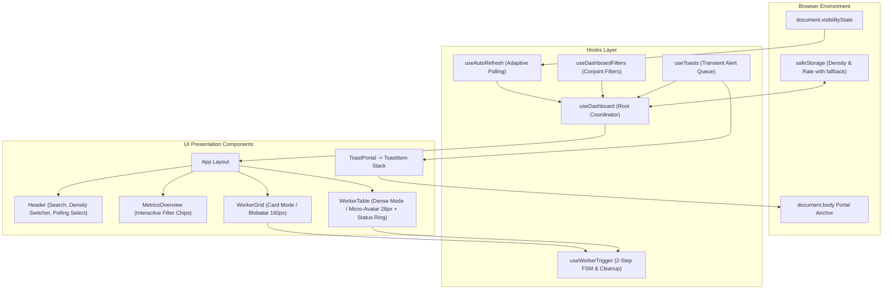

# UI/UX Overhaul & Observability Enhancements for Monitor Bot

*   **Author:** Sebastian
*   **Status:** In Review
*   **Date:** 2026-11-18

--------------------------------------------------------------------------------

## Overview

Monitor Bot provides centralized supervision and manual dispatching for microservices and cloud workers (e.g., Aiven, Aternos, Supabase). The current web dashboard communicates operational state primarily through animated `@blobatar/react` avatars, static counter cards, and modal triggers.

This design establishes an ergonomic overhaul of the web dashboard to transform it into a responsive, zero-layout-shift (Zero-CLS, Cumulative Layout Shift) operational dashboard. The overhaul introduces dual-density view switching (cards vs. table), interactive metric quick-filtering, decoupled floating notifications, adaptive background polling with Page Visibility suspension, and guarded two-step execution triggers, while leaving the backend Go architecture intact.

## The Problem

Operators monitoring the Monitor Bot cluster face four ergonomic friction points:

1. **Low Information Density**: Fixed 160px avatar canvas cards restrict the visible viewport to ~4–6 workers, requiring continuous scrolling to diagnose multi-service clusters.
2. **Cumulative Layout Shift (CLS)**: Alerts and sync confirmations inject directly into the content stream above the card grid, shifting clickable targets downward and causing accidental clicks or visual disorientation when they auto-dismiss after 3 seconds.
3. **Passive Telemetry & Stale Views**: The dashboard relies solely on manual page refreshes or initial mount fetches. Operators have no visibility into background status transitions unless they repeatedly click the refresh button.
4. **Unguarded Execution**: Triggering a worker run occurs via a single direct click with no confirmation buffer, exposing active production workflows to accidental dispatch.

## Goals

*   **Zero Layout Shift**: Extract all alert and sync notifications into an isolated `ToastPortal` anchored to `document.body`, eliminating CLS during notification mount and unmount.
*   **Dual View Density**: Provide an instant, persistent toggle between comfortable expressive card grid and high-density tabular view with micro-avatars.
*   **Interactive Metric Filtering**: Transform passive metric cards into keyboard-accessible quick-filter buttons (`role="button"`, `aria-pressed`) that evaluate conjointly with text search (`status === activeFilter && matchesQuery`).
*   **Adaptive Background Polling**: Implement client-side synchronization (`useAutoRefresh`) with selectable cadences (Off, 15s, 30s, 60s) that automatically suspends when the browser tab is backgrounded.
*   **Guarded Inline Triggering**: Implement a 2-step inline confirmation pattern (`Trigger` -> `Confirm? (3s)`) on action buttons to prevent accidental execution without modal interruption.
*   **Strict Clean Architecture**: Enforce single-responsibility hooks and subcomponents under the strict `< 150 LOC` rule (lines of code per `AGENTS.md`) with zero `any` types.

## Non-Goals

*   **No Backend Go API or Protocol Changes**: No alterations to Go server routes, database schemas, or mutex handlers (no SSE, WebSockets, or gRPC streaming).
*   **No Third-Party State or Grid Libraries**: No addition of Redux, Zustand, TanStack Table, or AG Grid dependencies.
*   **No Avatar Visual Redesign**: No modification to `@blobatar/react` facial expressions, SVG rendering, or visual personality.
*   **No Multi-Tenant RBAC**: Authentication remains bound to the current token/session scheme without granular Role-Based Access Control (RBAC) hierarchies.

## Open Questions

*   **Question 1**: In compact table view, should multi-target service badges expand on row click, or navigate directly to the existing `WorkerDetailModal` (the slide-out inspector detailing monitored services and execution history)?

## Critical User Journeys (CUJs)

### CUJ 1: Triage Degraded Workers under High Node Count

*   **Given**: An operator opens the dashboard monitoring 15 registered workers, 2 of which are in `degraded` state.
*   **When**: The operator clicks the "Alert / Paused" metric chip and toggles density mode to "Table View".
*   **Then**: The view instantly isolates the 2 affected workers in a dense, scannable table showing target services, error messages, and last execution timestamps without layout jumps.

### CUJ 2: Continuous Background Monitoring with Zero CPU Waste

*   **Given**: An operator leaves the dashboard open in a background browser tab while working in an IDE, configured with a 15-second polling interval.
*   **When**: The tab loses visibility (`document.visibilityState === "hidden"`).
*   **Then**: The auto-refresh loop halts immediately, generating zero network requests. When the operator returns to the tab (`visible`), the dashboard executes an immediate reconciliation fetch.

### CUJ 3: Safe Manual Worker Dispatch

*   **Given**: An operator views a healthy worker in either Grid or Table view and intends to trigger a manual check cycle.
*   **When**: The operator clicks `⚡ Trigger`.
*   **Then**: The button transitions into an amber `Confirm? (3s)` state. Clicking again within 3 seconds queues the run; allowing it to expire or clicking another worker returns the button to idle with no request sent.

--------------------------------------------------------------------------------

## Technical Plan (Architecture)

### 1. High-Level System Architecture & Component Mapping

The client architecture transitions from a monolithic dashboard hook into a decomposed, single-responsibility hook hierarchy composed within pure presentation views.

### 2. State Management & Hook Decomposition

1. **`useAutoRefresh.ts` (< 75 LOC)**:
   * Accepts `intervalSeconds: 0 | 15 | 30 | 60` and `onTick: () => Promise<void>`.
   * Listens to `visibilitychange` on `document`. When `document.hidden === true`, clears active interval timer.
   * On return to `document.hidden === false`, triggers immediate tick and re-establishes interval.
   * Tracks consecutive network errors. After 3 failures, pauses polling cadence and displays an amber alert badge on the Header refresh button ("Sync Paused: Network Issue — Click to Retry"). Clicking retry or refocusing the browser tab clears the error counter and resumes polling.

2. **`useDashboardFilters.ts` (< 85 LOC)**:
   * Holds `statusFilter: "all" | "operational" | "alert"` and `searchQuery: string`.
   * Maps backend states strictly: `"operational"` filters `WorkerStatus.OPERATIONAL`, while `"alert"` filters any worker with `degraded`, `error`, or `paused` status.
   * Evaluates filter conjunction: workers matching both search query and status filter (`matchesSearch && matchesStatus`).
   * Computes reactive counts: `total`, `operational`, `alertCount`.
   * Exposes helper `clearAllFilters()` to facilitate empty-state recovery.

3. **`useToasts.ts` (< 60 LOC)**:
   * Maintains queue of active toasts: `ToastMessage { id: string; type: "success" | "error" | "info"; text: string; durationMs: number }`.
   * Capped at 4 visible toasts (dropping oldest non-critical info toasts on overflow).
   * Auto-removes toasts on timer expiration or user dismiss click.

4. **`useWorkerTrigger.ts` (< 95 LOC)**:
   * Manages inline confirmation finite state machine:
     `IDLE` -> (Click Trigger) -> `CONFIRMING` (3s countdown) -> (Click Confirm) -> `EXECUTING` -> `FEEDBACK` (3s) -> `IDLE`.
   * Coordinates confirmation state via `activeConfirmationWorkerId` in `useDashboard` so that initiating confirmation on one worker automatically cancels any other pending confirmation.
   * Enforces `useEffect` timer cleanup on component unmount to eliminate memory and timer leaks.

### 3. Layout Stabilization (Zero-CLS Toast Portal)

All transient notifications are extracted from `<main>` flow and rendered via `createPortal(..., document.body)` inside a fixed top-right container (`z-index: 9999`).

* **Container properties:** `position: fixed; top: 1.5rem; right: 1.5rem; max-height: calc(100vh - 3rem); overflow-y: auto; pointer-events: none; display: flex; flex-direction: column; gap: 0.75rem;`.
* **Toast properties:** `pointer-events: auto; animation: slideIn 200ms ease-out;`. Includes explicit dismiss button (`✕`).
* **Accessibility:** Declares `role="region"` with `aria-live="polite"` for sync confirmations and `aria-live="assertive"` for operational errors.
* **Benefit:** Grid and Table dimensions never recalculate or shift when alerts appear or dismiss.

### 4. Data Synchronization & Concurrency Safeguards

* **Mutation Lock**: When a worker execution trigger is in-flight, `useDashboard` tracks a monotonic mutation sequence counter. Polling responses received during an active mutation are filtered so that optimistic worker execution states are not overwritten by stale in-flight GET responses.
* **Request Abort Safety**: Every polling cycle creates an `AbortController`. If a new poll or manual refresh is initiated before the prior network call completes, the pending request is aborted immediately.
* **Storage Resilience**: Persistence of density preference and refresh cadence is managed via a `safeStorage` helper that catches `QuotaExceededError` or `SecurityError` (e.g. in private browsing) and falls back to in-memory React state.
* **Responsive Strategy**: `WorkerTable` is wrapped in an `overflow-x: auto` container with semantic `<th scope="col">` headers. Viewports below 640px automatically default to Card Grid view and disable the density toggle. Micro-avatars (28px) in table rows are enclosed by a 2px high-contrast status color ring for instant peripheral recognition.

--------------------------------------------------------------------------------

## 5. Phased Implementation Roadmap

* **Phase 1: Foundation & Layout Stabilization (Zero CLS)**
  * Create `safeStorage` utility.
  * Implement `ToastPortal` and `useToasts` hook with `createPortal(..., document.body)`.
  * Implement `useAutoRefresh` hook with Page Visibility suspension and 3-failure error dampening.
* **Phase 2: Interactive Filtering & Information Architecture**
  * Implement `useDashboardFilters` with status mapping and `clearAllFilters()` recovery.
  * Refactor `MetricsOverview` into clickable `aria-pressed` filter chips.
* **Phase 3: Dual-Density View & Guarded Interactions**
  * Create `WorkerTable` and `WorkerTableRow` with 28px micro-avatars and status rings.
  * Add View Toggle in `Header` with `safeStorage` persistence and mobile viewport guard (<640px).
  * Upgrade `useWorkerTrigger` with 2-step inline confirmation and centralized mutual exclusion.

--------------------------------------------------------------------------------

## 6. Verification & Testing Strategy

* **Unit Tests (`@testing-library/react`)**:
  * `useAutoRefresh.test.ts`: Verify timer pauses when `document.hidden === true` and fires immediately upon `visibilitychange` to visible. Verify auto-pause after 3 consecutive rejections.
  * `useDashboardFilters.test.ts`: Verify conjoint filtering (`searchQuery` + `statusFilter`) and `clearAllFilters()` reset.
  * `useWorkerTrigger.test.ts`: Verify transition from `IDLE` -> `CONFIRMING` -> `EXECUTING` -> `FEEDBACK` -> `IDLE`, timeout reversion to `IDLE` after 3s, and timer cleanup on unmount.
  * `safeStorage.test.ts`: Verify in-memory fallback when `window.localStorage` throws a `DOMException`.

--------------------------------------------------------------------------------

## Alternatives Considered

### Alternative 1: Server-Sent Events (SSE) or WebSockets for Live Push Telemetry
*   **Reason for Rejection**: *Out of scope*. Zero backend Go code modifications is a strict constraint. Configurable client-side polling with tab-visibility suspension achieves 95% of the real-time operational utility without backend changes.

### Alternative 2: Replace `@blobatar/react` Entirely with Monochromatic Status Dots
*   **Reason for Rejection**: *Ergonomic compromise*. Preserving the comfortable card grid for high-level monitoring while introducing a compact table mode (with 28px micro-avatars and high-contrast status rings) satisfies both expressive identity and high-density triage.

### Alternative 3: Full Dialog Confirmation Modal for Worker Triggers
*   **Reason for Rejection**: *Excessive interaction friction*. A two-step inline confirmation button (`Trigger` -> `Confirm? (3s)`) provides reliable protection against errant clicks without interrupting the operator with an intrusive modal context switch.

### Alternative 4: Global State Store (Zustand or Redux Toolkit)
*   **Reason for Rejection**: *YAGNI*. Decomposed custom hooks composed cleanly inside `useDashboard` provide strict type safety, zero bundle overhead, and maintainable local scope.

### Alternative 5: Heavy Table Engines (TanStack Table or AG Grid)
*   **Reason for Rejection**: *Premature optimization*. A semantic HTML `<table>` styled natively with CSS Modules delivers instant rendering, full responsiveness, keyboard navigation, and zero third-party dependencies while complying with clean architecture standards.
